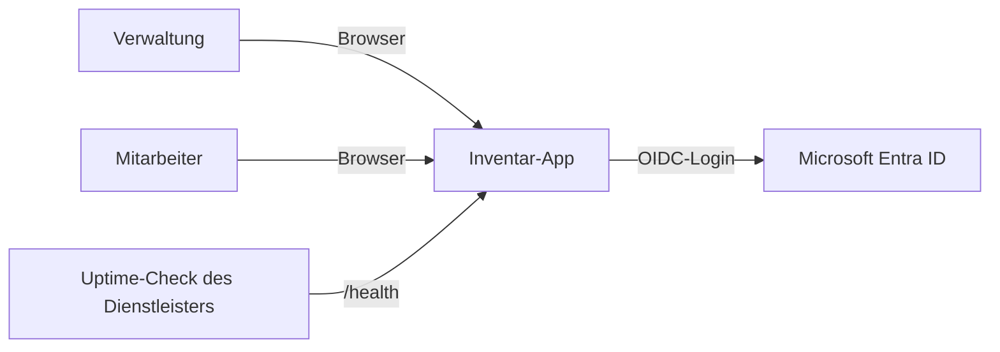
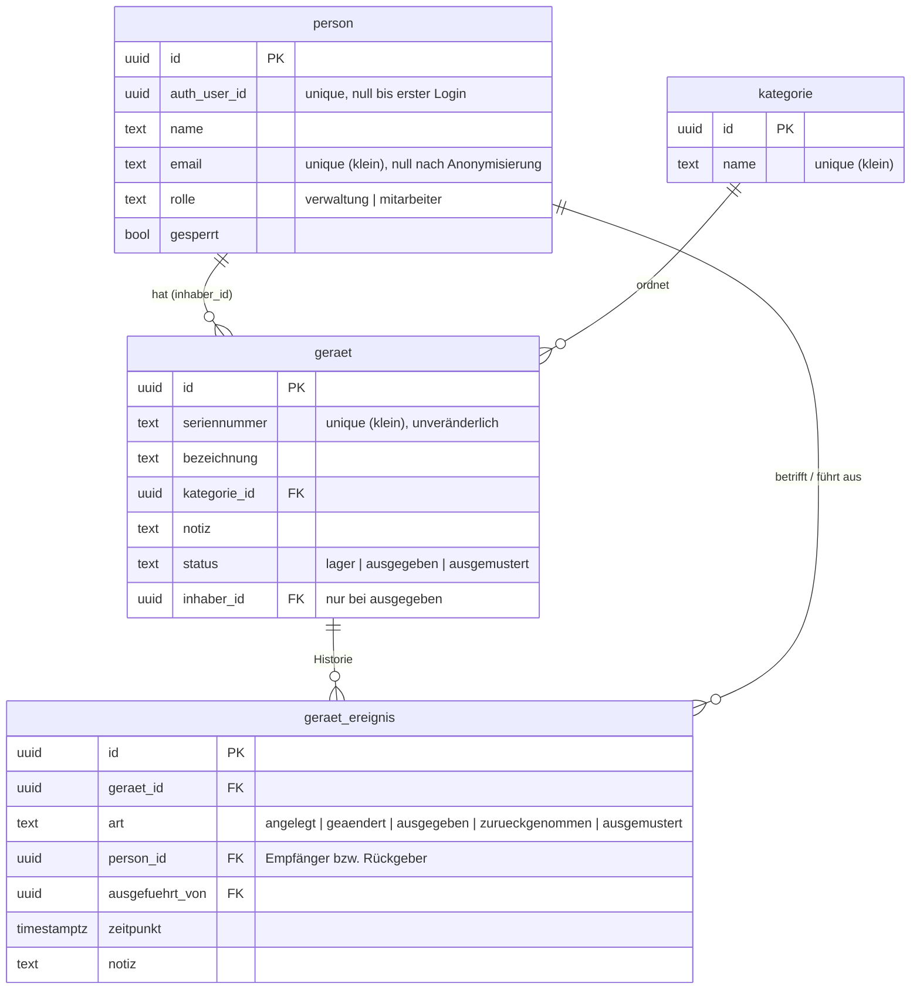
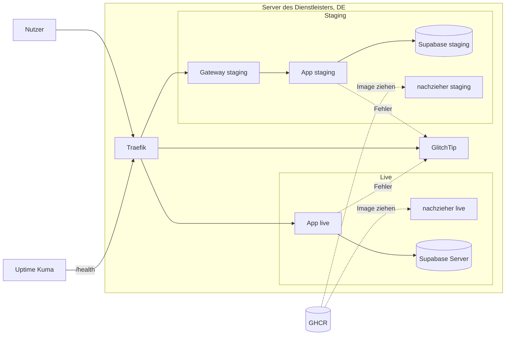

# Architektur: Geräte-Inventar fürs Büro

Auftraggeber: Büro (ca. 25 Personen), Issue #1 · Stand: 2026-11-25 · Klasse: M · Heikel: nein · Risiko: keins
Profil: profile/nextjs-supabase · Ziel: ziele/vps
Status: Entwurf

Prüfen: `python3 {SKILL_DIR}/scripts/pruefe_architektur.py .` · Rechnen: `python3 {SKILL_DIR}/scripts/rechnen.py . --schreiben`

## 1. Kurzfassung
- **App-Typ:** A Internes Werkzeug (Verwaltung mit Historie); bricht zuerst an Rechten und Datenqualität.
- **In einem Satz:** Das Büro (ca. 25 Leute) verwaltet Laptops, Monitore, Handys und Headsets: wer hat was, mit Historie.
- **Architektur in 5 Zeilen:**
  1. Ein Next.js-Container (modularer Monolith, Module `geraet`, `person`, `kategorie`) hinter dem vorhandenen Traefik.
  2. Daten und Login in der vorhandenen Supabase des Servers, eigenes Schema `APP_SCHEMA` (E2); Login nur Microsoft Entra ID, ein Mandant.
  3. Ausgabe, Rücknahme, Ausmustern laufen je als eine DB-Funktion: Zustand und Historie in einer Transaktion (E1).
  4. RLS an jeder Tabelle; Mitarbeiter lesen nur über `meine_geraete()`; Historie nur anhängend.
  5. Staging als eigener Stack mit kleiner Supabase; der Server zieht `staging`/`prod` selbst (`nachzieher`), Fehler an GlitchTip, externer Check auf `/health`.

## 2. Anforderungen (aus dem Interview)
| # | Frage | Antwort |
|---|---|---|
| 1 | Was tut die App, für wen? Eine Funktion für Tag 1? | Geräte erfassen, an Mitarbeiter ausgeben und zurücknehmen, ausmustern; Übersicht mit Filter und Suche; Historie je Gerät. Kern: Ausgabe und Rücknahme, ein Gerät ist immer im Lager oder bei genau einer Person (Issue). |
| 2 | Rollen, wer ruft die Schnittstelle auf? | Zwei Rollen: Verwaltung (2–3 Personen, benennt die Verwaltung selbst in der App; erste Verwaltungsperson ist, wer die App einrichtet), Mitarbeiter (sehen nur ihre eigenen aktuellen Geräte, keine früheren). Nur eigene App, kein Partnerzugriff (Annahme). Anmeldung nur mit dem Microsoft-Firmenkonto (Issue). |
| 3 | Nutzer, Aktionen, Stunden, Spitzen, Antwortzeit? | Bestätigt: 25 Nutzer, 10 Aktionen/Tag, 8 h, Spitze × 5, DACH; p95 < 500 ms als Messpunkt, nicht zugesagt. |
| 4 | Daten, Menge, Aufbewahrung? | Personenbezogen: Name und Firmen-Mail der Mitarbeiter, Zuordnung Gerät zu Person. Nicht heikel. Menge: wenige hundert Geräte, einige tausend Historienzeilen/Jahr. Aufbewahrung: bestätigt, Historie unbegrenzt (Issue: nicht löschen); Seriennummer bleibt für immer reserviert, keine Wiederaufnahme in V1. Ausgeschiedene Mitarbeiter: Konto gesperrt, Name bleibt in der Historie, Löschung personenbezogener Angaben nur auf Anfrage. Daten nur auf einem Server in Deutschland (Issue). |
| 5 | Mandanten? | Nein (ein Büro). |
| 6 | Web, Handy, offline? | Web, mobil nutzbar; keine Handy-App, kein Offline (Issue: nicht nötig). |
| 7 | Anbindungen? | Microsoft-Firmenkonto-Login (Entra ID); Tenant-ID trägt die IT des Büros bei der Einrichtung ein, die App-Registrierung legt das Büro selbst an. Sonst keine. Nicht nötig: Bestellungen, Rechnungen, Barcode-Scanner. |
| 8 | Hosting, Ausfall, RTO, RPO? | Bestätigt: vorhandener Server beim deutschen Dienstleister des Büros (ARM, Docker mit Portainer und Traefik, Supabase läuft dort bereits); Betrieb dort, Testversion (Staging) und Live. 99,5 % per externem Check auf `/health`; RTO 4 h, RPO 24 h; keine Bereitschaft, keine SLA. |

### Annahmen
- Nur eigene App ruft die Schnittstelle auf → betrifft Abschnitt 4
- Kategorien (Start: Laptop, Monitor, Handy, Headset) pflegt die Verwaltung selbst (bestätigt) → betrifft Abschnitt 5
- Seriennummer ist je Gerät eindeutig, auch über ausgemusterte Geräte hinweg (bestätigt) → betrifft Abschnitt 5
- Entschieden (E2): Live nutzt die vorhandene Supabase des Servers mit eigenem Schema; Staging eine eigene kleine → betrifft Abschnitt 7, 11
- Neu, beim Auftraggeber bestätigen: Die Verwaltung legt neue Mitarbeiter vorab mit Name und Firmen-Mail an, damit sie ein Gerät bekommen, bevor sie sich je angemeldet haben; der erste Microsoft-Login verknüpft das Konto → betrifft Abschnitt 5, 10
- Neu, beim Auftraggeber bestätigen: Die vorhandene Supabase dient nur Apps dieses Büros (ein Microsoft-Mandant im Login-Dienst) → betrifft Abschnitt 10
- Neu: Der Dienstleister sichert den Server täglich (RPO 24 h hängt daran) und betreibt einen Uptime-Check außerhalb des Servers → betrifft Abschnitt 11
- Neu: Mehrfaktor-Anmeldung erzwingt das Büro in Microsoft (Conditional Access), nicht die App → betrifft Abschnitt 10

### Umfang
- **Version 1:** Geräte anlegen und ausmustern, Ausgabe und Rücknahme, Übersicht mit Filter (Kategorie, Status) und Suche nach Seriennummer, Historie je Gerät, Mitarbeiter-Sicht, Kategorien pflegen (Verwaltung), Personen vorab anlegen, sperren und auf Anfrage anonymisieren (Verwaltung).
- **Nicht in Version 1:** Bestellungen, Rechnungen, Barcode, Handy-App, Export.

## 3. Qualitätsziele
Rang 1 gewinnt im Konflikt.

| Kennung | Rang | Merkmal | Szenario | Zielwert | Nachweis |
|---|---|---|---|---|---|
| Q1 | 1 | Zugriffsschutz | Wenn ein Mitarbeiter die Geräteliste lädt, fremde Gerät-IDs abruft oder eine Verwaltungs-Action aufruft, dann sieht und ändert er nur seine eigenen Geräte | 0 fremde Zeilen, 0 erfolgreiche Verwaltungs-Aufrufe | make test |
| Q2 | 2 | Datenintegrität | Wenn ein Gerät ausgegeben wird (auch zweimal gleichzeitig), dann ist es danach bei genau einer Person und hat genau einen Historieneintrag | 0 Geräte mit 2 Besitzern, 0 doppelte Seriennummern, 0 Zustandswechsel ohne Historie | make test |
| Q3 | 3 | Datenschutz und Herkunft | Wenn Inventar- oder Personendaten gespeichert oder Fehler gemeldet werden, dann nur auf dem Server in Deutschland | 0 Dienste außerhalb des Servers mit Inventardaten | make check |
| Q4 | 4 | Wiederherstellbarkeit | Wenn der Server ausfällt, dann ist die App aus der Sicherung wieder da | RTO 4 h, RPO 24 h | make restore |
| Q5 | 5 | Änderbarkeit | Wenn ein Modul ein anderes nutzt, dann nur über dessen `index.ts` | 0 Importe an der Schnittstelle vorbei | make modulgrenzen |

## 4. Kontext

| Akteur oder System | Art | Interview |
|---|---|---|
| Verwaltung | Rolle | Frage 2: 2–3 Personen, alles lesen und schreiben |
| Mitarbeiter | Rolle | Frage 2: nur eigene aktuelle Geräte lesen |
| Microsoft Entra ID | Anbindung | Frage 7: Login, ein Mandant, Registrierung durch das Büro |
| Uptime-Check des Dienstleisters | Anbindung | Frage 8: externer Check auf `/health` |

## 5. Daten
Schema aus `APP_SCHEMA` (nie fest im Code). IDs `uuid` (`gen_random_uuid()`; Tabellen klein, UUIDv7 unnötig), Zeiten `timestamptz` in UTC, jede Tabelle mit `created_at`/`updated_at`.

| Tabelle | Inhalt | Personenbezogen | Wer liest | Wer schreibt | Konsistenz (stark / darf nachhängen) |
|---|---|---|---|---|---|
| `person` | Mitarbeiter und Verwaltung, Rolle, Sperre | `name`, `email` | Verwaltung alle; Mitarbeiter nur die eigene Zeile (`auth_user_id = auth.uid()`) | nur über DB-Funktionen der Verwaltung; Verknüpfung beim ersten Login über `person_verknuepfen()` | stark |
| `kategorie` | Laptop, Monitor, … | nein | alle angemeldeten, nicht gesperrten Personen | Verwaltung (RLS-Regeln je Aktion, kein Löschen in V1) | stark |
| `geraet` | Gerät mit aktuellem Status und Inhaber | `inhaber_id` | nur Verwaltung; Mitarbeiter über `meine_geraete()` (nur Bezeichnung, Kategorie, Seriennummer, seit) | nur über DB-Funktionen (E1), keine direkte Insert/Update-Regel | stark |
| `geraet_ereignis` | Historie, nur anhängend | `person_id`, `ausgefuehrt_von` | nur Verwaltung | nur DB-Funktionen; Trigger verbietet Update, Delete, Truncate | stark |

**Regeln in der Datenbank (Q2):** Check `(status = 'ausgegeben') = (inhaber_id is not null)`; `inhaber_id` ist eine Spalte, also höchstens ein Besitzer; Unique-Index auf `lower(seriennummer)` über alle Geräte, auch ausgemusterte; Seriennummer per Trigger unveränderlich. Ausgabe ist ein bedingtes Update `… where id = $1 and status = 'lager'`; 0 Zeilen = Konflikt. Gesperrte Personen bekommen nichts. Löschen gibt es nicht; Anonymisieren setzt `name = 'Gelöscht'`, `email = null` (Einbahnstraße, nur gesperrt und ohne Geräte).

**Indizes:** `geraet(inhaber_id)`, `geraet(kategorie_id)`, `geraet(status)`, `geraet_ereignis(geraet_id, zeitpunkt)`, `geraet_ereignis(person_id)`, `geraet_ereignis(ausgefuehrt_von)`, `person(auth_user_id)` unique, `person(lower(email))` unique. Suche nach Seriennummer: Präfix über den Unique-Index; `pg_trgm` erst mit Auslöser (Stufe 9).

**Schnittstellen** (nur die eigene App, keine OpenAPI): Server Actions mit Umschlag in `src/lib/` (Sitzung → Recht → Zod), Rückgabe `{ ok: true, … }` oder `{ ok: false, code, referenz }`. Jede Action kennt dazu `nicht_angemeldet`, `nicht_erlaubt`, `ungueltig`.

| Action / Route | Wer | Fachliche Fehlercodes |
|---|---|---|
| `geraetAnlegen` | Verwaltung | `seriennummer_vergeben`, `kategorie_unbekannt` |
| `geraetBearbeiten` (Bezeichnung, Kategorie, Notiz) | Verwaltung | `nicht_gefunden`, `ausgemustert` |
| `geraetAusgeben` | Verwaltung | `nicht_gefunden`, `nicht_im_lager`, `person_gesperrt` |
| `geraetZuruecknehmen` | Verwaltung | `nicht_gefunden`, `nicht_ausgegeben` |
| `geraetAusmustern` | Verwaltung | `nicht_gefunden`, `ist_ausgegeben`, `bereits_ausgemustert` |
| `kategorieAnlegen`, `kategorieUmbenennen` | Verwaltung | `name_vergeben`, `nicht_gefunden` |
| `personAnlegen` (Name, Firmen-Mail) | Verwaltung | `email_vergeben` |
| `personRolleSetzen` | Verwaltung | `nicht_gefunden`, `letzte_verwaltung` |
| `personSperren`, `personEntsperren` | Verwaltung | `nicht_gefunden`, `hat_geraete`, `letzte_verwaltung` |
| `personAnonymisieren` | Verwaltung | `nicht_gefunden`, `nicht_gesperrt`, `hat_geraete` |
| Lesen: Geräteliste (Filter, Suche, `limit` 50, max. 200), Gerät mit Historie, Personen, Kategorien | Verwaltung | `nicht_erlaubt` |
| Lesen: `meine_geraete()` | jede verknüpfte, nicht gesperrte Person | – (leer, wenn nichts ausgegeben) |
| `GET /auth/callback` (Code-Tausch, dann `person_verknuepfen()`) | Login | `kein_zugang` (keine Person zur Mail, gesperrt oder kein Microsoft-Konto) |
| `GET /health` (öffentlich: DB-Abfrage im Schema, `revision`) | Uptime-Check | 503 bei DB- oder Schemafehler |

## 6. Rechnung
Werte aus Frage 3 und 4; unbekannt = Annahme mit Vermerk. Ergebnisse schreibt `rechnen.py`.
```text
nutzer_aktiv_tag = 25              # Frage 3, bestätigt
aktionen_je_nutzer = 10            # Frage 3, bestätigt
aktive_stunden_tag = 8             # Frage 3, Bürozeiten DACH
spitzenfaktor = 5                  # Frage 3, bestätigt
anteil_schreiben = 0,3             # Annahme: Ausgabe/Rücknahme/Anlage, Rest Nachschlagen
bytes_je_schreiben = 1000          # Annahme: Gerät bzw. Historienzeile mit Index
aufbewahrung_jahre = 10            # Annahme: „unbegrenzt“ für die Rechnung als 10 Jahre
p95_ms = 500                       # Messpunkt, nicht zugesagt
db_aufrufe_je_anfrage = 3          # Sitzung, Rolle, Daten
lasttest = nein                    # keine Zahl zugesagt (Frage 3)
anfragen_s_mittel = 0,00868
anfragen_s_spitze = 0,0434
lasttest_rps = 1
daten_gb_gesamt = 0,274
```
Was bricht bei 10-fachem Wachstum (250 Personen)? Nichts an Last oder Daten; zuerst die Bedienung (Listen ohne Seiten, Personenauswahl ohne Suche). Darum Listen von Anfang an mit `limit`.

## 7. Bausteine und Dienste
Modularer Monolith: `src/modules/geraet`, `person`, `kategorie`, je `index.ts` als einzige Schnittstelle (Q5). Muster: Health Endpoint, Gateway Routing (Traefik), Federated Identity (Entra ID über Supabase Auth), Deployment Stamps (eigener Stack je Umgebung).

| Dienst | Aufgabe | Grund | RAM MB | €/Monat | Pflege h/Monat |
|---|---|---|---|---|---|
| Traefik | Eingang, TLS (vorhanden) | Kern | 0 | 0 | 0 |
| App live | Next.js, Node 26 | Kern | 768 | 0 | 0,5 |
| Supabase Server | Postgres, Auth, PostgREST (vorhanden, eigenes Schema) | Kern, E2 | 0 | 0 | 0,5 |
| nachzieher live | folgt Tag `prod` | Kern | 64 | 0 | 0,1 |
| Gateway staging | Eingang des Staging-Stacks | Kern | 32 | 0 | 0,1 |
| App staging | Next.js gegen Staging-Supabase | Kern | 512 | 0 | 0,2 |
| Supabase staging | kleine eigene Supabase, nur Testdaten | Kern, Frage 8 | 1024 | 0 | 0,5 |
| nachzieher staging | folgt Tag `staging` | Kern | 64 | 0 | 0,1 |
| GlitchTip | Fehlerüberwachung (all-in-one mit eigenem kleinem Postgres, ohne Valkey) | Q3, Frage 8 | 768 | 0 | 0,5 |
| Uptime Kuma | externer Check, nicht auf diesem Server (Dienstleister) | Frage 8 | 0 | 0 | 0,1 |

Preis: Der Server ist bezahlt; die App kostet 0 € zusätzlich, braucht aber rund 4 GB RAM (`server_ram_min_gb`), Staging-Supabase ist der größte Posten. GlitchTip ist ab Klasse M Standard der Stack-Karte (laut Doku 512 MB empfohlen, Postgres 14+, Valkey optional; 768 MB inkl. eigenem Postgres); gibt es auf dem Server schon GlitchTip, wird es mitgenutzt und die Zeile fällt weg. Node 26 ist laut nodejs.org (geprüft 2026-11-25) LTS; Support nach 30-Monats-Regel bis voraussichtlich Ende April 2029, im Gerüst gegen den Release-Plan bestätigen.

## 8. Abläufe
1. **Erster Login / Einrichtung:** Microsoft-Login → `/auth/callback` tauscht den Code → `person_verknuepfen()` sucht eine Person mit derselben Mail ohne `auth_user_id`, nur wenn der Nutzer eine Identität vom Anbieter `azure` hat → verknüpft. Gibt es noch keine Verwaltung und ist die Mail gleich `VERWALTUNG_START_EMAIL`, wird diese Person angelegt und Verwaltung (E3). Fehler: keine passende Person, gesperrt oder kein Microsoft-Konto → Abmelden und Seite „kein Zugang, bitte an die Verwaltung wenden“ (`kein_zugang`); fehlt `VERWALTUNG_START_EMAIL` und es gibt keine Verwaltung, startet `/health` mit 503 (laut scheitern).
2. **Ausgabe:** Verwaltung wählt Gerät und Person → `geraetAusgeben` prüft Sitzung, Rolle, Eingabe → `geraet_ausgeben(geraet, person)` in einer Transaktion: Person nicht gesperrt, bedingtes Update auf `status = 'lager'`, Ereignis `ausgegeben`. Fehler: 0 Zeilen → `nicht_im_lager` mit aktuellem Inhaber; zwei Klicks gleichzeitig → einer gewinnt, der andere bekommt `nicht_im_lager` (Test mit parallelen Aufrufen).
3. **Rücknahme:** `geraet_zuruecknehmen(geraet)`: bedingtes Update `status = 'ausgegeben'` → `lager`, `inhaber_id = null`, Ereignis `zurueckgenommen` mit dem bisherigen Inhaber. Fehler: `nicht_ausgegeben`.
4. **Ausmustern:** nur aus `lager`; Ereignis `ausgemustert` mit Pflicht-Notiz. Fehler: `ist_ausgegeben` (erst zurücknehmen). Die Seriennummer bleibt reserviert.
5. **Mitarbeiter scheidet aus:** Verwaltung nimmt Geräte zurück → `personSperren` (sonst `hat_geraete`) → Sitzung wird beim nächsten Aufruf abgewiesen (Sperre wird bei jeder Action und in RLS geprüft). Auf Anfrage `personAnonymisieren`: Historie bleibt, zeigt „Gelöscht“.

## 9. Skalierung: was bricht zuerst?
Antipatterns geprüft: keine Logik in Triggern außer Schutzregeln (Busy Database), Listen mit `limit` und genannten Spalten (Extraneous Fetching), Supabase-Client je Anfrage aus dem Cookie, kein Neuaufbau teurer Objekte (Improper Instantiation). Keine Mail, keine Webhooks, keine öffentlichen Formulare: Stufen 4, 5, 6, 13 entfallen.

| Stufe | Symptom | Messen | Auslöser (Zahl) | Lösung | Preis | In Version 1? |
|---|---|---|---|---|---|---|
| 0 Start | – | – | – | ein Server, eine DB, ein Monolith | ein Ausfallpunkt | ja |
| 1 Langsame Abfragen | Liste oder Historie langsam | p95 je Route im Log, `EXPLAIN ANALYZE` | p95 > 500 ms | Indizes aus Abschnitt 5, weitere nur nach Messung | jedes Schreiben minimal teurer | ja (bekannte Indizes) |
| 7 Gleichzeitige Zugriffe | Gerät zweimal ausgegeben | Test mit parallelen Aufrufen | ab Tag 1 (Q2) | bedingtes Update + Check-Regel | keiner nennenswert | ja |
| 2 Server voll | Seiten langsam für alle | `docker stats` | CPU/RAM dauerhaft > 70 % | größerer Server oder Staging zeitweise stoppen | Mehrkosten beim Dienstleister | nein |
| 9 Suche | Suche langsam | Dauer der Suchabfrage | p95 > 500 ms oder > 100.000 Geräte | `pg_trgm`-Index | eine Erweiterung | nein |

Stufe 10 vorbereitet: App zustandslos, nichts lokal gespeichert.

## 10. Sicherheit
ASVS-Stufe 1, weil intern, nicht heikel, keine Zahlung, keine öffentliche Registrierung, ein Mandant. Schwerpunkt Typ A: Rollen und Historie.

**Kernpunkte (★)**
- Login über fertigen Anbieter: umgesetzt durch Supabase Auth mit Anbieter Azure, Tenant-URL `https://login.microsoftonline.com/<tenant-id>`, App-Registrierung „nur dieser Mandant“; Tenant-ID nur in `.env` (Repo ist öffentlich).
- Sitzung auf dem Server: umgesetzt durch `getClaims()`/`getUser()` im Action-Umschlag und in `/auth/callback`; Test „ohne Login → `nicht_angemeldet`“ je Action.
- Rechte auf dem Server und je Zeile: umgesetzt durch Umschlag (Rolle aus `person`, nie vom Client) plus RLS an jeder Tabelle; Test „Mitarbeiter A ruft Verwaltungs-Action / Gerät von B“ → `nicht_erlaubt`, Daten unverändert (Q1).
- BOLA: jede `geraet_id`/`person_id` wird in der DB-Funktion gegen die Rolle geprüft; Mitarbeiter haben keine Leseregel auf `geraet`.
- Eingaben per Zod, SQL nur über supabase-js und Funktionsparameter; keine Ausgabe von Nutzertext als HTML.
- Geheimnisse nur in `.env` (Server `chmod 600`), `.env.example` ohne Werte; gitleaks über die ganze Historie.
- Nach außen nur 80/443 über Traefik und SSH; Ports-Prüfung nach server-betrieb.md, Abschnitt 2.
- SSH nur mit Schlüssel: Server des Dienstleisters, Prüfregel in der Betriebsanleitung, Nachweis vor Livegang.
- HTTPS mit HSTS, ohne `X-Powered-By` (`poweredByHeader: false`).
- Abhängigkeiten: Dependabot wöchentlich, Images mit fester Version, Trivy im Job `image`.
- Logs ohne Tokens und ohne Mail-Adressen (nur Person-ID), Correlation-ID je Anfrage.
- Hosting in der EU: alles auf dem Server in DE (siehe Datenschutz-Rollen).

**Weitere Punkte:** Mass Assignment: Actions nehmen nur die Felder ihres Zod-Schemas, `rolle` nur über `personRolleSetzen`. Audit-Spur: `geraet_ereignis` nur anhängend per Trigger. Fehler mit festem Code und Referenz-ID, nie Stacktrace. CSRF: Server Actions prüfen Origin (Next.js), Cookies `SameSite=Lax`. Zwei-Faktor: über Microsoft (Annahme oben). Admin-Oberflächen (Supabase Studio, GlitchTip) hinter Authelia. Nicht relevant, weil keine Uploads, keine Webhooks, keine Fremd-API-Abrufe (kein SSRF), keine Partner-API-Keys, keine Zahlung, keine KI, keine öffentlichen Formulare. Login-Bremse liegt bei Microsoft. Löschkonzept: Anonymisieren auf Anfrage (Abschnitt 5).

### Datenschutz-Rollen
Personenbezogene Daten: Name, Firmen-Mail, Zuordnung Gerät–Person mit Zeiten. Verarbeitet von:
- App, Supabase Server, GlitchTip: Server des Dienstleisters in Deutschland.
- Microsoft Entra ID: nur Login-Identität (Konto besteht beim Büro ohnehin); keine Inventardaten fließen dorthin.
- GitHub (Code, CI, Images): keine Personendaten; Tests und Staging nur mit erfundenen Daten.
- Uptime Kuma: nur `/health`, keine Personendaten.

### Bedrohungsmodell
- Woran arbeiten wir? Zuordnung Gerät–Person mit Historie (Nachweis, wer welches Gerät hat), Verwaltungsrechte, Personendaten von ca. 25 Mitarbeitern.
- Was kann schiefgehen? (1) Ein Mitarbeiter liest fremde Geräte oder ruft Verwaltungs-Actions direkt auf. (2) Jemand ohne Firmenkonto kommt über den gemeinsamen Login-Dienst rein, etwa per Mail-Registrierung mit der Mail eines Mitarbeiters, und wird mit dessen Person verknüpft. (3) Historie wird nachträglich geändert oder ein Gerät doppelt vergeben.
- Was tun wir dagegen? (1) Umschlag + RLS, Negativ-Test je Action und Tabelle → `make test` (Q1). (2) Verknüpfung nur bei Identität vom Anbieter `azure` des eingestellten Mandanten, sonst `kein_zugang`; Test „Mail-Konto mit gleicher Adresse wird nicht verknüpft“ → `make test`; erste Verwaltung nur über `VERWALTUNG_START_EMAIL` (E3). (3) DB-Funktionen mit bedingtem Update, Check-Regel, Trigger gegen Update/Delete/Truncate auf der Historie → `make test` (Q2).
- Reicht das? Ja für Stufe 1, solange die Annahme stimmt, dass im Login-Dienst des Servers nur der Mandant des Büros eingetragen ist; sonst eigener Login-Dienst (Stufe 03 klärt mit dem Auftraggeber). Innerhalb des Mandanten vertrauen wir der Mail aus Microsoft, weil nur die IT des Büros sie vergeben kann.

## 11. Betrieb
- **Deployment:** Merge → CI baut einmal (amd64 + arm64, Repo öffentlich: Minuten frei) → `sha-<commit>` und `staging`; Staging zieht selbst. Promote setzt `prod` auf denselben Digest. Migration läuft beim Containerstart mit `MIGRATE_DATABASE_URL`, sichert vorher das App-Schema.
- **Rollback:** Promote mit altem SHA; Migrationen nur anhängend. Notfall: `IMAGE_TAG=sha-…` in der `.env`.
- **Überwachung:** Uptime Kuma prüft `/health` jede Minute mit Zertifikatswarnung, Alarm per Mail an Verwaltung und Dienstleister (Annahme); GlitchTip meldet neue Fehler; `nachzieher` meldet fehlgeschlagene Updates.
- **Single Points of Failure:** Server (Wiederherstellung durch den Dienstleister aus der Tagessicherung, RTO 4 h), Supabase Server (wie Server), Microsoft Entra ID (Ausfall = niemand meldet sich an; wir warten, keine Umgehung).
- **Sicherung:** täglich durch den Dienstleister (Annahme); dazu Schema-Sicherung vor jeder Migration. `make restore` spielt in der CI einen Dump des App-Schemas in eine frische DB und prüft Zeilenzahlen (Q4).
- **Fristen (Kalender, 30 Tage Vorlauf):** Client-Secret der Microsoft-App-Registrierung (läuft spätestens nach 24 Monaten ab; danach kein Login), Domain, Node-26-Support-Ende. Image auf GHCR öffentlich (keine Geheimnisse im Image), daher kein Lese-Token; wird das Repo privat, kommt ein Lese-Token mit Ablauf dazu.
- **Mail:** die App sendet keine Mails; SPF/DKIM/DMARC nicht relevant.
- RTO 240 min ist größer als das Ausfallbudget: ein Totalausfall verbraucht den Monat. Ehrlich so zugesagt, weil ohne Bereitschaft.
```text
verfuegbarkeit_prozent = 99,5
fenster_tage = 30
messort = externer Check (Uptime Kuma des Dienstleisters) auf /health, jede Minute
bereitschaft = nein, Reaktion werktags zu Bürozeiten
regel_bei_ueberschreitung = nur noch Fehlerbehebung, bis das Budget wieder frei ist
rto_min = 240
rpo_min = 1440
ausfallbudget_min = 216
server_ram_min_gb = 3,95
kosten_eur_monat = 0
pflege_h_monat = 2,6
```

## 12. Nicht in Version 1
- Export (CSV) → kommt, wenn die Verwaltung ihn für Inventur oder Steuer braucht
- Barcode-Scanner → kommt bei mehr als ca. 1.000 Geräten oder Inventur vor Ort
- Mails (z. B. Übergabe-Bestätigung) → kommt auf Wunsch; dann Stufe 4 (Job) und SMTP des Büros
- Seriennummer wiederverwenden → kommt, wenn ein ausgemustertes Gerät zurückkehren soll
- `pg_trgm`-Suche → Auslöser aus Abschnitt 9

## 13. Über der Klasse
Leer.

## 14. Entscheidungen
| Kennung | Entscheidung | Treiber | Bestätigung | Datei |
|---|---|---|---|---|
| E1 | Ausgabe, Rücknahme, Ausmustern als DB-Funktion in einer Transaktion | Q2 | make test | entscheidungen/001-zustandswechsel-als-db-funktion.md |
| E2 | Live in der vorhandenen Supabase des Servers, eigenes Schema | Frage 8, Q4 | make e2e | entscheidungen/002-vorhandene-supabase.md |
| E3 | Erste Verwaltungsperson über `VERWALTUNG_START_EMAIL` | Q1 | make test | entscheidungen/003-erste-verwaltung.md |

## 15. Glossar
| Begriff | Bedeutung in einem Satz | Beispiel |
|---|---|---|
| ADR | Eine Datei je Architekturentscheidung mit Optionen, Grund, Preis. | `001-zustandswechsel-als-db-funktion.md` |
| Audit-Log | Nur anhängendes Protokoll, wer wann was geändert hat. | `geraet_ereignis`: „Laptop 17 an Person X“ |
| Bedingtes Update | Änderung, die nur greift, wenn der alte Zustand noch stimmt. | `… where status = 'lager'`; 0 Zeilen = schon vergeben |
| BOLA | Zugriff auf ein fremdes Objekt durch Ändern der ID. | Gerät-ID eines Kollegen in die Anfrage setzen |
| Correlation-ID | Kennung, die eine Anfrage durch alle Logs begleitet. | Referenz in der Fehlermeldung = Logzeile |
| Entra ID | Microsofts Login-Dienst für Firmenkonten. | „Mit Microsoft anmelden“ |
| Fitness-Test | `make`-Ziel, das ein Qualitätsziel bei jedem Bau misst. | `make modulgrenzen` |
| Modularer Monolith | Eine App, ein Deployment, innen Module je Fachbegriff. | `src/modules/geraet` |
| nachzieher | Dienst im Stack, der ein neues Image desselben Tags zieht. | Staging folgt `staging` |
| OIDC | Anmeldeprotokoll mit ID-Token. | Microsoft-Login |
| p95 | Wert, unter dem 95 % der Messungen liegen. | p95 = 300 ms: 95 % sind schneller |
| RLS | Regel je Zeile, wer sie sehen oder ändern darf. | Mitarbeiter sieht nur eigene Geräte |
| RTO / RPO | Höchstdauer der Wiederherstellung / höchster Datenverlust. | 4 h / 24 h |
| Server Action | Funktion in Next.js, die das Formular auf dem Server aufruft; öffentlich erreichbar. | `geraetAusgeben` |
| Single Point of Failure | Baustein, dessen Ausfall alles stoppt. | der eine Server |
| Staging | Testversion mit eigenen Daten, gleiches Image wie Live. | `inventar-staging.…` |

Ergebnisse von Sicherheitstests, Lasttest stehen in `docs/NACHWEISE.md`, nicht hier.
